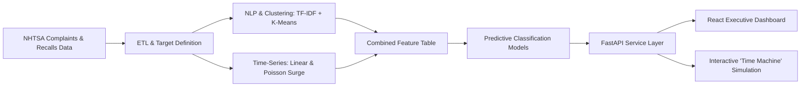

# 🛡️ RecallRadar
> **Predictive Early Warning System for Automotive Recalls**  
> *Samsung AI Capstone Project — Team APORIA (21-Day Sprint)*

[](https://fastapi.tiangolo.com/)
[](https://react.dev/)
[](https://scikit-learn.org/)
[](https://www.nhtsa.gov/nhtsa-datasets-and-apis)

---

## 🎯 Project Core Question
> **"Will this cluster of consumer complaints (Make + Model + Component) culminate in an official NHTSA recall within the next 12 months?"**

RecallRadar processes unstructured consumer safety complaints filed with the NHTSA, clusters them into distinct failure modes, calculates multi-factor risk scores using time-series velocity and text indicators, and flags critical defects months before an official recall is announced.

---

## 👥 Team & Ownership

| Name | Role | Core Responsibilities |
| :--- | :--- | :--- |
| **Mahmoud** | Full Stack Engineer | System architecture, Time Machine interactive mode, API integration |
| **Faisal** | Full Stack Engineer | Database design, FastAPI backend routes, React Dashboard UI |
| **Ghadeer** | AI & NLP Specialist | Text preprocessing, TF-IDF + PCA, K-Means defect clustering, Naive Bayes/SVM safety filter |
| **Aya** | AI & Time-Series Specialist | Complaint velocity, trend slopes (Linear Regression), Poisson baseline spike detection |
| **Mahdy** | AI & Modeling Specialist | NHTSA ETL & label matching, predictive classification (Logistic vs RF/GB), temporal validation & Lead Time |

---

## 🏗️ Architecture Overview



---

## 📁 Repository Structure

```text
recall-radar/
├── data/
│   ├── raw/                  # Downloaded NHTSA flat files (Git-ignored)
│   └── processed/            # Cleaned parquet datasets for modeling
├── ml/                       # Owned by Ghadeer, Aya & Mahdy
│   ├── notebooks/            # Exploratory research & prototyping
│   ├── src/
│   │   ├── etl.py            # Download, clean & join complaints with recalls
│   │   ├── nlp_clustering.py # TF-IDF, TruncatedSVD/PCA, K-Means
│   │   ├── time_series.py    # Poisson baseline & trend slopes
│   │   ├── train_models.py   # Logistic Regression vs RF/GBoosting
│   │   └── evaluate.py       # Strict temporal split, PR-AUC, Lead Time
│   ├── artifacts/            # Exported models & vectorizers
│   └── requirements.txt
├── backend/                  # Owned by Mahmoud & Faisal
│   ├── app/
│   │   ├── main.py           # FastAPI entrypoint
│   │   ├── schemas.py        # Pydantic contract models
│   │   ├── mock_data.py      # Seed & mock simulation data
│   │   └── routes/           # REST endpoints (/alerts, /timemachine, /vehicles)
│   └── requirements.txt
└── frontend/                 # Owned by Mahmoud & Faisal
    ├── src/
    │   ├── components/       # Dashboard, TimeMachine, RiskCard, Charts
    │   ├── services/         # Axios API client
    │   └── App.jsx
    └── package.json
```

---

## 🚀 Quickstart Guide

### 1. Backend Setup
```bash
cd backend
python3 -m venv venv
source venv/bin/activate  # On Windows: venv\Scripts\activate
pip install -r requirements.txt
uvicorn app.main:app --reload --port 8000
```
API Documentation will be live at: `http://localhost:8000/docs`

### 2. Frontend Setup
```bash
cd frontend
npm install
npm run dev
```
Dashboard will be live at: `http://localhost:5173`

### 3. ML Pipeline Setup
```bash
cd ml
pip install -r requirements.txt
# Run the ETL starter script
python src/etl.py --sample
```

---

## ⏱️ 21-Day Sprint Roadmap

* **Days 1–3:** Repository setup, API contract definition, NHTSA data download & initial linking.
* **Days 4–7:** Full ETL pipeline, TF-IDF + PCA + K-Means clustering, Mock FastAPI & Frontend shell.
* **Days 8–11:** Poisson & Trend regression, baseline Logistic Regression, first temporal validation.
* **Days 12–14:** Comparison models (Random Forest, Gradient Boosting), hyperparameter tuning, model freeze.
* **Days 15–17:** End-to-end integration: Backend connects to trained models, Time Machine UI interactive.
* **Days 18–19:** Evaluation metrics calculation (PR-AUC, Precision@k, Lead Time), presentation slides.
* **Days 20–21:** Rehearsal with backup demo recordings and final submission.
